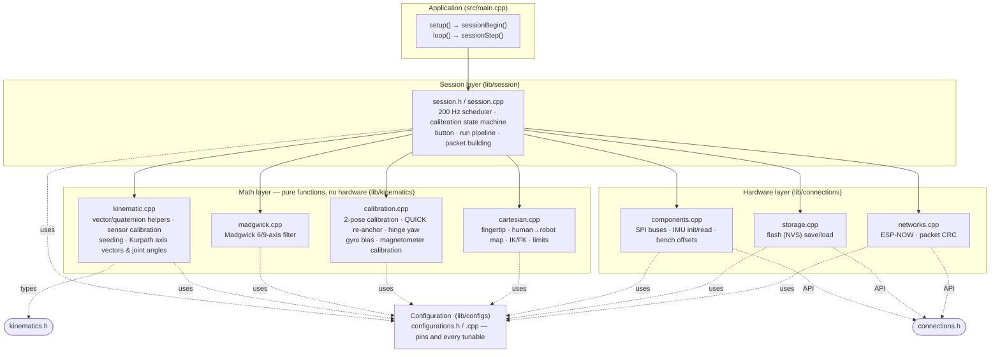
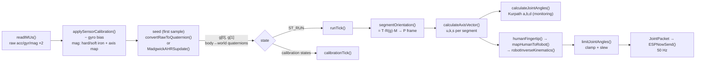
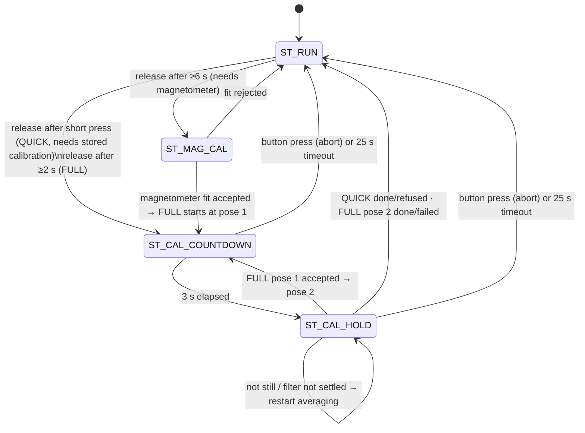

# TeleArm master — architecture and `session.cpp` reference

This document explains (1) how the master firmware is organised and how data flows through it, and
(2) what every function in `lib/session/session.cpp` does, which other headers/files it depends on, and who calls it.
Operating instructions and the list of design decisions are in [`master_firmware.md`](master_firmware.md).

> Status: tested on a PC simulation only (see `tests/host/`). Not yet validated on real hardware.

---

## 1. Architecture at a glance

### 1.1 Layers

The firmware is four layers. A layer only calls the layer below it; the hardware layer never calls upward.



Header ownership (repo convention: one `.h` per `lib/` folder, one or more `.cpp` including it):

| Folder | Header | Implementation files | Role |
|---|---|---|---|
| `lib/configs` | `configurations.h` | `configurations.cpp` | Pins (final) and all tunables, declared `extern const`, defined once |
| `lib/kinematics` | `kinematics.h` | `kinematic.cpp`, `madgwick.cpp`, `calibration.cpp`, `cartesian.cpp` | All data types + pure maths. Includes `MPU9250_WE.h` only for `xyzFloat` and the driver class names |
| `lib/connections` | `connections.h` | `components.cpp`, `storage.cpp`, `networks.cpp` | Everything that touches hardware, flash or radio, plus the `JointPacket` format |
| `lib/session` | `session.h` | `session.cpp` | Orchestration. Includes `kinematics.h` and `connections.h` |
| `src` | — | `main.cpp` | `setup()` / `loop()` only |
| `src/slave_rx_test` | — | `slave_rx_test.cpp` | Separate sketch for the slave ESP32 (env `slave_test`) |

Why this split: the maths layer has no `#include` of anything hardware-specific except `xyzFloat`, so it compiles and is unit-tested on a PC
(`tests/host/`). The session layer is the only place that knows *when* things happen; it contains no maths of its own.

### 1.2 Data flow per tick (200 Hz)



Frames used along the way (details in the header comment of `kinematics.h`):

- **W** — Madgwick world frame: x north (or arbitrary heading without magnetometer), y west, z up.
- **P** — Kurpath frame: X right, Y up, Z back. Reached from W through the calibration matrix `T`.
- **Sensor frame** — the PCB axes. The calibration matrix `M` maps them to the limb axes (k along the limb, u up, s side).
- Segment orientation in P: `A = T · R(g) · M`, with `R(g)` the rotation matrix of the Madgwick quaternion.

### 1.3 Runtime state machine



Packets are only produced in `ST_RUN` **and** when `IsMPUSynced()` is true.

### 1.4 Who owns what data

| Data | Owner | Lifetime |
|---|---|---|
| `CalibrationData cal` (sensor cal, mounting `M`, heading `T`, flags) | `session.cpp` (anonymous namespace) | RAM; copy persisted in flash by `storage.cpp` |
| Madgwick quaternions `g[2]` | `session.cpp` | RAM, reseeded at boot / after magnetometer calibration |
| Raw / calibrated samples `raw[2]`, `cd[2]` | `session.cpp` | overwritten every tick |
| Bench offsets (accelerometer/gyro offsets inside the MPU) | `components.cpp` + flash key `bench` | written to the chips at `MPUInit()` |
| Packet sequence number, send stats | `networks.cpp` | RAM |

Index convention used everywhere in `session.cpp`: **0 = upper arm (MPU9250, or MPU6500 if no 9250 is fitted), 1 = forearm (MPU6500).**

### 1.5 Timing

`sessionStep()` is called as fast as `loop()` spins but does work only when `micros()` passes the next 5 ms boundary (`SAMPLE_RATE_HZ` = 200).
`dt` is the measured time since the previous tick, clamped to `[DT_MIN_S, DT_MAX_S]` = [1, 20] ms. If the loop falls more than five periods behind,
the schedule is re-synchronised instead of trying to catch up. Packets go out on every 4th tick (50 Hz).

---

## 2. `session.h` — public interface

| Symbol | Meaning |
|---|---|
| `enum SessionState { ST_RUN, ST_CAL_COUNTDOWN, ST_CAL_HOLD, ST_MAG_CAL }` | Current mode of the state machine |
| `bool sessionBegin()` | Initialise everything (call once from `setup()`) |
| `void sessionStep()` | Do one scheduler pass (call from `loop()`) |
| `bool IsMPUSynced()` | Both segments calibrated **and** heading-anchored in this power cycle |
| `SessionState sessionState()` | Introspection (tests/debug) |
| `const CalibrationData &sessionCalibration()` | Introspection |
| `void sessionJointCommand(float[3])` | Last computed robot joint command |
| `joints sessionHumanJoints()` | Last Kurpath `a,b,d` of the operator's arm |
| `xyzFloat sessionRobotTarget()` | Last robot pen target [m] |

`session.h` includes `Arduino.h`, `kinematics.h` (types) and `connections.h` (packet type, hardware API). Anything that includes `session.h` therefore sees all of them.

---

## 3. `session.cpp` — function reference

Everything below `namespace {` is private to `session.cpp`. For each function: **purpose**, **called by**, **depends on** (function → header → file that implements it).

### 3.1 Public functions

#### `bool sessionBegin()`
**Purpose.** Reset every runtime variable, set up pins, start the hardware, run the optional bench-offset procedure, and load the stored calibration.
Returns `false` if the IMUs or ESP-NOW failed to start (the loop still runs so the problem can be reported; nothing is sent).

Steps, in order:
1. Reset state: tick counters, `state = ST_RUN`, fault counters, `seeded[] = false`, `prevJoint`/`jointCmd` = 0, `cal = CalibrationData()` (all zero), `magScale = 1`, `g[] = identity`.
2. `pinMode(btn_cal, INPUT_PULLUP)`; vibration pin set LOW (feature postponed).
3. `MPUInit()` and `ESPNowInit()`.
4. **Bench mode**: if the button is held at power-on for ≥ `BTN_LONG_MS`, `benchCalibrateIMUs()` runs (IMUs must lie flat), and the stored gyro biases are zeroed because they were measured against the old offsets.
5. `loadCalibration()`. If valid: copy it, set `seg9250.anchored` only when the calibration was magnetometer-referenced (`calUsedMag`), always clear `seg6500.anchored` (the forearm heading cannot survive a reboot), then print which action the operator must take (QUICK or FULL).
6. Print the session summary line.

**Called by** `setup()` in `src/main.cpp`.
**Depends on**
| Call | Header | Implemented in |
|---|---|---|
| `MPUInit`, `benchCalibrateIMUs`, `magnetometerAvailable` | `connections.h` | `components.cpp` |
| `ESPNowInit` | `connections.h` | `networks.cpp` |
| `loadCalibration`, `saveCalibration` | `connections.h` | `storage.cpp` |
| `CalibrationData`, `xyzFloat` | `kinematics.h` (`xyzFloat` from `MPU9250_WE.h`) | — (types) |
| `resetAcc` | — | `session.cpp` |
| `btn_cal`, `vibration_motor`, `SAMPLE_RATE_HZ`, `SEND_RATE_HZ`, `BTN_LONG_MS`, `USE_MAG_9250` | `configurations.h` | `configurations.cpp` |
| `pinMode`, `digitalRead`, `digitalWrite`, `delay`, `millis` | Arduino core | — |

#### `void sessionStep()`
**Purpose.** One scheduler pass. Returns immediately if the next 5 ms tick is not due. When due it:
1. computes `dt` (clamped) and `nowMs`;
2. `pollButton()` — the button is serviced even if the IMUs fail, so the operator can always abort;
3. `readIMUs()`; on failure sets `faultCooldown`, counts `badReads`, prints one message after 25 consecutive failures and **returns without touching the filters or sending anything**;
4. for each IMU: `applySensorCalibration()` → seed with `convertRawToQuaternion()` the first time (and start a 3 s high-gain window), otherwise `MadgwickAHRSupdate()` with the gain chosen by `boost` / magnetometer presence;
5. dispatches: `calibrationTick()` if `state != ST_RUN`, else `runTick()`.

Gain selection: `MADGWICK_BETA_BOOST` during calibration countdown/hold and for `BOOST_AFTER_SEED_MS` after a seed; otherwise `MADGWICK_BETA_9250` when the IMU delivers a magnetometer vector, else `MADGWICK_BETA_6500`.
When `USE_MAG_9250` is false the upper IMU's magnetometer vector is zeroed so it runs 6-axis.

**Called by** `loop()` in `src/main.cpp`.
**Depends on**
| Call | Header | Implemented in |
|---|---|---|
| `readIMUs` | `connections.h` | `components.cpp` |
| `applySensorCalibration`, `convertRawToQuaternion`, `vnorm` | `kinematics.h` | `kinematic.cpp` |
| `MadgwickAHRSupdate` | `kinematics.h` | `madgwick.cpp` |
| `pollButton`, `calibrationTick`, `runTick` | — | `session.cpp` |
| `DT_MIN_S`, `DT_MAX_S`, `MADGWICK_BETA_*`, `BOOST_AFTER_SEED_MS`, `USE_MAG_9250` | `configurations.h` | `configurations.cpp` |

#### `bool IsMPUSynced()`
**Purpose.** True when both segments have a valid mounting/heading calibration **and** both are anchored this power cycle. This is the gate for transmitting. Without a magnetometer (or after a reboot) the forearm is never anchored until QUICK/FULL runs.
**Called by** `runTick()`, tests. **Depends on** `CalibrationData` / `SegmentCal` (`kinematics.h`).

#### Introspection accessors
`sessionState()`, `sessionCalibration()`, `sessionJointCommand()`, `sessionHumanJoints()`, `sessionRobotTarget()` return copies/references of private state. Used by the host tests and available for a debug display; the firmware itself does not need them.

### 3.2 Private functions (anonymous namespace)

#### `void say(const char *s)`
Prints `[CAL] <text>` on the serial monitor. Used by every calibration message.

#### `void resetAcc()`
Zeroes the `HoldAcc` accumulator (`memset`). Called whenever a new averaging window starts: `sessionBegin`, `startPlan`, `calibrationTick` (countdown → hold), `finishHold` (not still / not settled / next pose), `finishMagCal`.

#### `void accumulate()`
**Purpose.** Called once per tick during `ST_CAL_HOLD`. For each IMU it adds to `acc`: the raw gyro sum and sum of squares (for the stillness test), the Madgwick quaternion (sign-aligned to the first one, because `q` and `−q` are the same rotation), and the tilt error — the angle between the gravity direction predicted by the filter (third row of its rotation matrix) and the measured acceleration. The tilt error tells whether the filter has converged.
**Called by** `calibrationTick`.
**Depends on** `rotationFromQuaternion`, `vunit`, `vcross`, `vdot`, `vnorm` (`kinematics.h` → `kinematic.cpp`); reads `raw[]`, `cd[]`, `g[]`.

#### `quaternion meanQuat(int i)`
Normalised average of the accumulated quaternions of IMU `i` — the orientation of the held pose with noise averaged out. Called by `finishHold`. Depends on `qNormalize` (`kinematic.cpp`).

#### `void clearSyncFlags(bool both)`
Marks the forearm (and optionally the upper arm) as not anchored. Used when QUICK fails, so a half-applied calibration cannot be used for transmitting. Called by `finishHold`.

#### `void abortCalibration(const char *why)`
Prints the reason, returns to `ST_RUN`, clears the plan. Calling sites: button press during calibration, 25 s timeout, QUICK without a valid stored calibration, magnetometer calibration impossible/failed.

#### `void beginPose(int idx, uint32_t nowMs)`
Enters `ST_CAL_COUNTDOWN` for pose 1 or 2, restarts the 3 s countdown, prints the pose instruction. Called by `startPlan`, `finishHold` (FULL pose 1 → pose 2), `finishMagCal`.

#### `void startPlan(Plan p, uint32_t nowMs)`
**Purpose.** Starts a calibration plan chosen by the button gesture. Records `calStartMs` (for the timeout), clears the accumulator, then:
- `PLAN_MAG_THEN_FULL`: requires `magnetometerAvailable()`, otherwise aborts. Enters `ST_MAG_CAL` and clears the sample buffer.
- `PLAN_QUICK`: requires `seg[0]->valid && seg[1]->valid && seg[0]->anchored` (a stored, magnetometer-referenced calibration), otherwise aborts with an explanation.
- otherwise `beginPose(1)`.

**Called by** `onRelease`. **Depends on** `magnetometerAvailable` (`connections.h` → `components.cpp`).

#### `void saveAll()`
Sets `cal.calUsedMag` (1 only if `USE_MAG_9250` and the magnetometer calibration is valid) and writes the whole `CalibrationData` to flash. Prints a warning if the write fails. Called by `finishHold` and `finishMagCal`.
**Depends on** `saveCalibration` (`connections.h` → `storage.cpp`).

#### `void finishHold(uint32_t nowMs)`
**Purpose.** Evaluates a completed 2 s pose hold. This is the core of the calibration procedure.
1. **Stillness**: `computeGyroBias()` per IMU; if any gyro axis has std-dev above `CAL_STILL_GYRO_DPS` → "not still", restart the window.
2. **Filter settled**: if mean tilt error of either IMU exceeds `CAL_SETTLE_TILT_DEG` → print both values, restart the window (the countdown/hold does not advance; this is the "keeps holding" message).
3. **Pose 1**: store averaged quaternions in `g1[]` and the measured gyro bias in `SensorCal::gyroBias`.
   - *QUICK*: verify both limbs really hang vertically (limb axis from the stored `M`, rotated by the filter quaternion, must be within `QUICK_POSE_TOL_DEG` of straight down) — otherwise "QUICK refused", nothing changed. Then `reanchorSegment6500()` re-derives the forearm heading matrix `T` from the already-anchored upper arm; success saves to flash.
   - *FULL*: go on to pose 2 (`beginPose(2)`).
4. **Pose 2 (FULL)**: average into `g2[]`, call `computeSegmentCalibration(g1, g2, ...)` per IMU to obtain `M` and `T`. Both must succeed (pose 2 must be a real horizontal forward raise) before the new values replace the old ones; then both segments are marked anchored and saved.

**Called by** `calibrationTick`.
**Depends on**
| Call | Header | Implemented in |
|---|---|---|
| `computeGyroBias`, `computeSegmentCalibration`, `reanchorSegment6500` | `kinematics.h` | `calibration.cpp` |
| `rotationFromQuaternion`, `mat3MulVec` | `kinematics.h` | `kinematic.cpp` |
| `meanQuat`, `beginPose`, `saveAll`, `clearSyncFlags`, `resetAcc`, `say` | — | `session.cpp` |
| `CAL_STILL_GYRO_DPS`, `CAL_SETTLE_TILT_DEG`, `QUICK_POSE_TOL_DEG` | `configurations.h` | `configurations.cpp` |

#### `void finishMagCal(uint32_t nowMs)`
**Purpose.** Ends the 20 s magnetometer rotation. `computeMagCalibration()` fits hard-iron offset, per-axis soft-iron scale and detects the AK8963 axis mapping from the collected `magBuf`. On failure → abort. On success: store the result in `cal.s9250`, **invalidate both segment calibrations** (the heading reference changed), force the upper arm to be re-seeded with the new calibrated magnetometer, save, then continue straight into a FULL sequence (`plan = PLAN_FULL`, fresh 25 s timeout, pose 1).
**Called by** `calibrationTick`.
**Depends on** `computeMagCalibration` (`kinematics.h` → `calibration.cpp`), `MagSample` (`kinematics.h`), `saveAll`, `beginPose`.

#### `void onRelease(uint32_t heldMs, uint32_t nowMs)`
Maps the button hold time to an action when the button is released. Any release while a calibration is running aborts it. Otherwise: ≥ `BTN_VERYLONG_MS` → magnetometer + full; ≥ `BTN_LONG_MS` → full; shorter → quick. Called by `pollButton`.

#### `void pollButton(uint32_t nowMs)`
Debounces the active-LOW button on `btn_cal` (`BTN_DEBOUNCE_MS`), records the press time, and calls `onRelease()` on a stable release. Called every tick by `sessionStep`, **before** the IMU read, so the button works even when the IMUs fail.
**Depends on** `digitalRead` (Arduino), `btn_cal`, `BTN_DEBOUNCE_MS` (`configurations.h`).

#### `void calibrationTick(uint32_t nowMs)`
**Purpose.** One tick of the calibration states (runs only after a successful IMU read).
- Timeout check (`CAL_TIMEOUT_MS` = 25 s from the start of the pose sequence; the magnetometer stage is exempt).
- `ST_CAL_COUNTDOWN`: prints `3… 2… 1… 0…` using `CAL_COUNTDOWN_MS`; at 0 enters `ST_CAL_HOLD` and clears the accumulator.
- `ST_CAL_HOLD`: `accumulate()`; after `CAL_HOLD_MS` calls `finishHold()`.
- `ST_MAG_CAL`: every 10th tick stores one `MagSample` (calibrated accelerometer + raw magnetometer of IMU 0, up to 600 samples); at `MAG_CAL_MS` or when the buffer is full calls `finishMagCal()`.

> Important consequence: because this function only runs after `readIMUs()` succeeds, **if the IMUs return implausible data the countdown never advances.** `components.cpp` now prints the offending values (`[IMU] implausible data: ...`) to make that visible.

**Called by** `sessionStep`. **Depends on** `CAL_TIMEOUT_MS` (local), `CAL_COUNTDOWN_MS`, `CAL_HOLD_MS`, `MAG_CAL_MS` (`configurations.h`), `vnorm`.

#### `void runTick(float dt, uint32_t t_us)`
**Purpose.** The normal operating pipeline, executed every tick in `ST_RUN`.
1. If `!IsMPUSynced()`: reset `wasSynced`, print a reminder every 5 s, return (nothing is sent).
2. `segmentOrientation()` for both segments (applies `T` and `M`); `calculateAxisVector()` → `u,k,s` vectors.
3. Optional `hingeYawCorrection()` (when `USE_HINGE_YAW_CORRECTION`): nudges the forearm world heading with `alignYawOffset_6500()` and recomputes the forearm vectors.
4. `calculateJointAngles()` → operator joints `a,b,d` (kept in `humanJ`; used for the debug CSV).
5. `humanFingertip()` → `mapHumanToRobot()` → robot target; `robotInverseKinematics()` → raw joint command (the previous command seeds the solver).
6. First synced tick: previous command := current (so the slew limit does not ramp from zero).
7. `limitJointAngles()` clamps to the joint limits, replaces NaN with the previous value and applies the slew limit (`MAX_JOINT_RATE_DPS`); returns flag bits.
8. Build `flags` (`PKT_F_CALIBRATED`, `PKT_F_MAG`, `PKT_F_LIMIT`, `PKT_F_SLEW`, `PKT_F_UNREACHABLE`, `PKT_F_IMU_FAULT` while `faultCooldown > 0`).
9. Every `SAMPLE_RATE_HZ / SEND_RATE_HZ`-th tick fill a `JointPacket` (joints, both segment quaternions, flags, timestamp) and `ESPNowSend()`.
10. If `DEBUG_CSV`, print one CSV line at 10 Hz: `ms, a, b, d, j0, j1, j2, flags`.

**Called by** `sessionStep`.
**Depends on**
| Call | Header | Implemented in |
|---|---|---|
| `segmentOrientation`, `calculateAxisVector`, `calculateJointAngles`, `alignYawOffset_6500` | `kinematics.h` | `kinematic.cpp` |
| `hingeYawCorrection` | `kinematics.h` | `calibration.cpp` |
| `humanFingertip`, `mapHumanToRobot`, `robotInverseKinematics`, `limitJointAngles` | `kinematics.h` | `cartesian.cpp` |
| `JointPacket`, `PKT_F_*`, `ESPNowSend` | `connections.h` | `networks.cpp` (type in header) |
| `SAMPLE_RATE_HZ`, `SEND_RATE_HZ`, `USE_HINGE_YAW_CORRECTION`, `USE_MAG_9250`, `DEBUG_CSV` | `configurations.h` | `configurations.cpp` |

### 3.3 Call graph

```
loop() ─ sessionStep()
           ├─ pollButton() ─ onRelease() ─ startPlan() ─ beginPose() / abortCalibration()
           ├─ readIMUs()                          [connections.h · components.cpp]
           ├─ applySensorCalibration()            [kinematics.h · kinematic.cpp]
           ├─ convertRawToQuaternion()            [kinematic.cpp]   (first sample / reseed)
           ├─ MadgwickAHRSupdate()                [madgwick.cpp]
           ├─ calibrationTick()
           │    ├─ accumulate()
           │    ├─ finishHold() ─ computeGyroBias, reanchorSegment6500, computeSegmentCalibration  [calibration.cpp]
           │    │                └ saveAll() ─ saveCalibration()                                    [storage.cpp]
           │    └─ finishMagCal() ─ computeMagCalibration()                                         [calibration.cpp]
           └─ runTick()
                ├─ IsMPUSynced()
                ├─ segmentOrientation / calculateAxisVector / calculateJointAngles                 [kinematic.cpp]
                ├─ hingeYawCorrection                                                              [calibration.cpp]
                ├─ humanFingertip / mapHumanToRobot / robotInverseKinematics / limitJointAngles    [cartesian.cpp]
                └─ ESPNowSend()                                                                    [networks.cpp]

setup() ─ sessionBegin() ─ MPUInit / benchCalibrateIMUs [components.cpp] · ESPNowInit [networks.cpp]
                          · loadCalibration / saveCalibration [storage.cpp]
```

### 3.4 Private state variables

| Variable | Meaning |
|---|---|
| `periodUs`, `nextTickUs`, `lastTickUs`, `tickInit`, `tickCount` | Scheduler (5 ms period, tick counter used for decimation) |
| `cal`, `scal[2]`, `seg[2]` | Calibration data and per-IMU pointers into it (`scal` = sensor cal, `seg` = mounting/heading) |
| `g[2]`, `seeded[2]`, `boostUntilMs[2]` | Madgwick quaternions, seed flags, end of the high-gain window |
| `raw[2]`, `cd[2]` | Raw and calibrated samples of the current tick |
| `badReads`, `faultCooldown`, `faultReported` | IMU-read failure tracking |
| `state`, `plan`, `poseIdx`, `stateStartMs`, `calStartMs`, `lastCountdownPrint` | Calibration state machine |
| `acc` (`HoldAcc`), `g1[2]`, `g2[2]` | Averaging window and the two pose results |
| `magBuf[600]`, `magN` | Magnetometer calibration samples |
| `btnRaw`, `btnStable`, `btnChangeMs`, `btnPressMs` | Button debounce |
| `wasSynced`, `prevJoint[3]`, `jointCmd[3]`, `humanJ`, `robotTarget`, `lastFlags` | Run-state outputs (`lastFlags` is currently write-only) |

### 3.5 Constants local to `session.cpp`

`MAG_MAX_SAMPLES` = 600, `CAL_TIMEOUT_MS` = 25000, `FAULT_TICKS` = 25 (≈125 ms before a failure message), `FAULT_FLAG_TICKS` = 100 (0.5 s `IMU_FAULT` flag). Everything else is in `configurations.cpp`.

---

## 4. The hardware layer in brief (`connections.h`)

| Function | File | What it does |
|---|---|---|
| `MPUInit()` | `components.cpp` | Starts both IMUs on separate SPI buses (VSPI = forearm, HSPI = upper arm). **If the upper-arm chip is an MPU6500 (WHO_AM_I 0x70) instead of an MPU9250 (0x71), it falls back to a plain MPU6500 driver, 6-axis only.** Applies stored bench offsets and the common settings (1 kHz internal rate, DLPF 4, ±500 dps, ±2 g). |
| `readIMUs()` | `components.cpp` | Reads both IMUs; returns false if either sample is implausible (\|acc\| outside 0.3–3 g, \|gyro\| ≥ 2000 dps or non-finite) |
| `magnetometerAvailable()` | `components.cpp` | True only if an MPU9250 and its AK8963 answered |
| `benchCalibrateIMUs()` | `components.cpp` | Library `autoOffsets()` with sanity limits; saved to flash |
| `loadCalibration()` / `saveCalibration()` | `storage.cpp` | NVS blob with magic, version and FNV-1a checksum; invalid blobs are rejected |
| `loadBenchOffsets()` / `saveBenchOffsets()` / `clearStorage()` | `storage.cpp` | Same for bench offsets / wipe |
| `ESPNowInit()` / `ESPNowSend()` / `ESPNowStats()` | `networks.cpp` | Wi-Fi STA + fixed channel, peer from `SLAVE_MAC`; `ESPNowSend` fills start byte, type, 16-bit sequence number and CRC-8 |
| `crc8()` / `packetValid()` | `networks.cpp` | Used by the master and by the slave receiver |

`JointPacket` (54 bytes, packed, little endian): `start 0xA5 · type · seq (uint16) · t_us (uint32) · joint_deg[3] (float) · q_upper[4] · q_fore[4] · flags · crc8`.

## 5. The maths layer in brief (`kinematics.h`)

| File | Contents |
|---|---|
| `kinematic.cpp` | `vdot vcross vnorm vunit`, `mat3*`, `q*`, `rotationFromQuaternion`, `quaternionFromRotation`, `applySensorCalibration`, `alignYawOffset_6500`, `convertRawToQuaternion` (seed), `convertQuaternionToEuler` (Kurpath Eq. 1), `segmentOrientation`, `calculateAxisVector` (Eq. 2–4), `calculateJointAngles` (Eq. 5, 6, 10) |
| `madgwick.cpp` | `MadgwickAHRSupdate`, `madgwickGradient` |
| `calibration.cpp` | `computeSegmentCalibration` (two-pose), `reanchorSegment6500` (QUICK), `hingeYawCorrection`, `computeGyroBias`, `computeMagCalibration` |
| `cartesian.cpp` | `humanFingertip`, `mapHumanToRobot`, `robotInverseKinematics`, `robotForwardKinematics`, `limitJointAngles` |

## 6. Extending the code

- **New button gesture / calibration step:** add a `Plan` value, handle it in `onRelease` and `startPlan`, add the processing in `finishHold`/`calibrationTick`.
- **Different robot geometry:** change the constants in `configurations.cpp`; if the joint definition changes, only `cartesian.cpp` (`robotInverseKinematics`/`robotForwardKinematics`) needs editing.
- **Another IMU or bus:** only `components.cpp`; the session layer sees `IMUData` and nothing else.
- **Slave side:** include `connections.h` (for `JointPacket` and `packetValid`), register an ESP-NOW receive callback, validate with `packetValid`, drive the servos with `joint_deg[0..2]`. See `src/slave_rx_test/slave_rx_test.cpp`.
- **Run the tests:** `MPU_LIB=<path to MPU9250_WE/src> ./tests/host/build_and_run.sh`.
